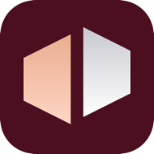

<p align="center"></p>

# 先行 · FirstMove

[English](./README.en.md) · [下载安装包](https://github.com/Yraguo/FirstMove/releases) · [服务器部署](#部署到阿里云或其他-linux-服务器)

先行是一个自托管的个人与小组工作台。打开日程，就能看见最近要交的作业、该开始准备的比赛和今天的打卡。手机、Mac 和 Windows 连到同一个服务器，使用同一个账号即可查看和更新自己的内容。

- **日程**按截止时间整理待办，区分高、中、低优先级，周历和月历显示任务时间线。时间还没定的事项可以先放进「等待确认」。
- **记录**支持文字、图片和附件，可以归入项目，之后再转成笔记或待办。资料先显示目录，需要时再下载。
- **项目**支持课程、比赛和个人项目。队长可以分配任务，每个人按自己的优先级安排工作。
- **离线**支持缓存最近同步的内容、手动保存附件以及恢复联网后发送待同步记录。提醒需要客户端页面处于运行状态。

## 安装客户端

在 [GitHub Releases](https://github.com/Yraguo/FirstMove/releases) 下载对应版本。客户端首次连接需要可访问的工作台地址。还没有服务器时，可以先按下一节在电脑上体验网页版。

| 设备 | 安装与连接 |
| --- | --- |
| Android 7.0 及以上 | 下载签名 APK 并安装。打开「先行」，输入工作台的 HTTPS 地址；客户端使用手机浏览器的自定义标签页打开工作台。 |
| Apple 芯片 Mac，macOS 13 或更高版本 | 下载 arm64 DMG，打开并将「先行」拖入 Applications。首次启动输入服务器地址。 |
| Windows x64 | 运行 Setup 安装程序，从开始菜单打开「先行」并输入服务器地址。 |

桌面端可以从「先行 → 连接服务器」更换地址。本机测试允许连接 `http://127.0.0.1:8000`。手机和其他电脑请使用服务器的 HTTPS 域名。首版桌面安装包未经 Apple 公证或 Windows 商业证书签名；下载来源和 SHA-256 可在 Release 页面核对。

## 在电脑上试用

需要 Git 和 Python 3.11 或更新版本。在 macOS 或 Linux 终端运行：

```sh
git clone https://github.com/Yraguo/FirstMove.git
cd FirstMove/backend
python3 -m venv .venv
.venv/bin/python -m pip install -r requirements.txt
.venv/bin/python manage.py create-owner --name owner
.venv/bin/python -m uvicorn app.main:app --host 127.0.0.1 --port 8000
```

Windows PowerShell 中用 `py -3.13 -m venv .venv` 创建环境（选择已安装的 Python 版本），将其余命令中的 `.venv/bin/python` 换成 `.\.venv\Scripts\python.exe`。在终端按提示设置至少 10 个字符的密码，打开 [本机工作台](http://127.0.0.1:8000/)。创建所有者只需执行一次。

## 部署到阿里云或其他 Linux 服务器

以下方案适用于一台 Linux 云服务器和一个域名。FastAPI 同时提供页面和 API，Caddy 负责 HTTPS，SQLite 与附件保存在持久化卷。部署后只需向使用者提供一个地址。

1. 在域名 DNS 控制台创建 A 记录，例如 `work.example.com`，指向服务器公网 IPv4。如果创建 AAAA 记录，也要确保 IPv6 可达。在阿里云安全组和系统防火墙放行公网 TCP 80 和 443；保留自己的 SSH 管理通道。确认 80 和 443 可供 Caddy 使用。安装 Git、Docker Engine 和 Compose 插件并确保当前账号可以运行 Docker。[Docker 官方安装指南](https://docs.docker.com/engine/install/)
2. SSH 登录服务器，在准备长期保留的目录中运行以下命令：

   ```sh
   git clone https://github.com/Yraguo/FirstMove.git
   cd FirstMove
   cp .env.example .env
   nano .env
   ```

   把 `FIRSTMOVE_DOMAIN` 改为你自己的域名，只填主机名。其余默认值为上海时区、每人 128 MiB、全站附件 1 GiB、单文件 16 MiB。给数据库日志、临时文件和备份额外留出磁盘空间。

3. 启动服务、创建第一个账号，然后检查公网入口：

   ```sh
   docker compose up -d --build
   docker compose exec app python manage.py create-owner --name owner
   docker compose ps
   curl --fail https://work.example.com/api/health
   ```

   最后一条换成真实域名。打开同一域名首页，以刚创建的账号登录。在「我的」生成邀请链接给朋友。证书签发失败时查看 `docker compose logs --tail=80 caddy`，同时核对 DNS 与端口。[Caddy HTTPS 指南](https://caddyserver.com/docs/quick-starts/reverse-proxy)

### 备份、更新与恢复

在服务器的仓库目录运行。以下在线备份使用 SQLite 备份接口，包含账号、任务、记录及附件。备份文件含私人数据，应另存到受限的备份位置。

```sh
umask 077
docker compose exec -T app python -c "import sqlite3; src=sqlite3.connect('/var/lib/firstmove/workspace.sqlite3'); dst=sqlite3.connect('/tmp/firstmove-backup.sqlite3'); src.backup(dst); dst.close(); src.close()"
docker compose cp app:/tmp/firstmove-backup.sqlite3 ./firstmove-backup.sqlite3
docker compose exec -T app python -c "from pathlib import Path; Path('/tmp/firstmove-backup.sqlite3').unlink()"
```

更新前备份，然后运行 `git pull --ff-only` 和 `docker compose up -d --build`。日常停机使用 `docker compose stop`；`docker compose down -v` 会删除数据卷。恢复时，保留原卷，另建一个新的 Compose 项目并沿用原配置。在空卷第一次启动应用前导入备份：

```sh
docker compose -p firstmove-restore run --rm --no-deps -T app python -c "import pathlib,sys; p=pathlib.Path('/var/lib/firstmove/workspace.sqlite3'); f=p.open('xb'); import shutil; shutil.copyfileobj(sys.stdin.buffer,f); f.close()" < firstmove-backup.sqlite3
docker compose stop
docker compose -p firstmove-restore up -d
```

登录恢复后的实例，核对任务和附件。之后在该实例的管理命令中继续使用 `-p firstmove-restore`。本地开发的默认数据位置是 `backend/data/`，线上为 Compose 的 `workspace` 卷。

## 项目结构

| 目录 | 用途 |
| --- | --- |
| `frontend/` | 原生 ES Modules、IndexedDB、Service Worker 与品牌资源 |
| `backend/` | FastAPI、SQLite、账号管理和集成测试 |
| `clients/` | Android 与桌面客户端、安装包构建说明 |
| `deploy/` | Caddy 反向代理配置 |

[后端配置与测试](backend/README.md) · [安装包构建说明](clients/README.md)

本项目使用 [MIT 许可证](LICENSE)。
